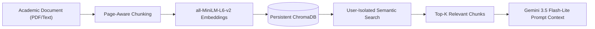

# CampusFlow AI – Retrieval-Augmented Generation (RAG) Implementation

## 1. Pipeline Overview
Retrieval-Augmented Generation (RAG) is implemented in `backend/app/services/rag_service.py` to prevent hallucinations and supply verified course context to the Gemini LLM.



---

## 2. Chunking & Ingestion
- **Document Chunk Size:** ~400 characters with 50-character overlap.
- **Page Header Detection:** Preserves page markers (`--- Page X ---`) generated by PyMuPDF so that every vector record retains its original `page_number`.
- **Relational Mirroring:** Every chunk is simultaneously persisted in PostgreSQL (`document_chunks` table) for referential integrity.

---

## 3. Vector Storage & ChromaDB
- **Storage Directory:** `./data/chroma` (Persistent across restarts).
- **Collection Name:** `campusflow_academic_knowledge`
- **Distance Metric:** Cosine similarity.
- **Metadata Fields:**
  - `user_id`: String (enforcing strict tenant isolation)
  - `document_id`: Integer
  - `document_name`: String
  - `page_number`: Integer
  - `chunk_index`: Integer
  - `source_type`: String ("pdf", "image", "text")

---

## 4. Multi-Tenant Cross-User Isolation
RAG queries always include the authenticated user's ID:
```python
results = collection.query(
    query_texts=[query],
    n_results=top_k,
    where={"user_id": str(user_id)}
)
```
This is verified by unit test `backend/tests/test_rag.py::test_rag_ingest_and_cross_user_isolation`, proving that User A's search can never return User B's documents.
