# CampusFlow AI – System Architecture

## Architecture Overview
The system follows a layered, decoupled architecture with five core tiers:
1. **Presentation Layer:** React 18, Vite, Tailwind CSS, Lucide React, and Recharts.
2. **API & Business Logic Layer:** Python 3.11 with FastAPI.
3. **LLM & Knowledge Retrieval Layer:** Google GenAI SDK (`google-genai`), Gemini 3.5 Flash-Lite (`gemini-3.5-flash-lite`), ChromaDB persistent vector database.
4. **Relational Persistence Layer:** PostgreSQL with SQLAlchemy ORM (and SQLite for isolated local unit tests).
5. **Deterministic Engine Tier:** Python priority calculation, conflict detection, study planner, dynamic rescheduling, and APScheduler reminder service.

```mermaid
flowchart TD
    subgraph Client ["Frontend Client (React + Vite)"]
        UI["Dashboard, Upload, Review, Tasks, Planner, Calendar, RAG, Alerts"]
    end

    subgraph Backend ["FastAPI REST Backend"]
        AuthRouter["Auth, Profile & Availability Routers"]
        AnnounceRouter["Announcement & Document Routers"]
        RAGRouter["RAG Vector Router"]
        TaskRouter["Task Management Router"]
        PlannerRouter["Planner & Reschedule Router"]
        ProgressRouter["Progress Analytics Router"]
        NotifRouter["Notification Router"]
        
        DocService["Document Service (PyMuPDF / OCR)"]
        GeminiService["Google GenAI SDK (Gemini 3.5 Flash-Lite)"]
        PromptService["Prompt Engineering Service"]
        RAGService["RAG Service (ChromaDB)"]
        Guardrails["Four-Layer Guardrail Service"]
        PriorityService["Deterministic Priority Engine"]
        ConflictService["Conflict Detection Engine"]
        PlannerService["Personalized Scheduling Engine"]
        SchedulerService["APScheduler Reminders"]
    end

    subgraph Storage ["Persistence Tier"]
        PG["PostgreSQL Relational DB"]
        Chroma["ChromaDB Vector Store"]
    end

    UI --> Backend
    AnnounceRouter --> DocService
    AnnounceRouter --> RAGService
    AnnounceRouter --> GeminiService
    GeminiService --> PromptService
    GeminiService --> Guardrails
    TaskRouter --> PriorityService
    PlannerRouter --> ConflictService
    PlannerRouter --> PlannerService
    PlannerService --> SchedulerService
    
    RAGService --> Chroma
    Backend --> PG
```

### Key Design Principles
- **No Direct LLM-to-DB Access:** All LLM inputs and outputs pass through backend validation and Human-in-the-Loop review before touching PostgreSQL.
- **Deterministic vs Probabilistic Separation:** Natural language understanding and extraction are delegated to the LLM; scheduling, date math, and numerical prioritization are executed strictly by deterministic Python algorithms.
- **Multi-Tenant User Isolation:** Every database entity and vector embedding chunk is tied to an authenticated `user_id`.
